

  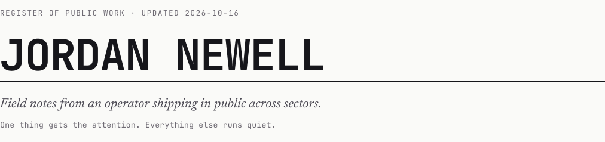

  <a href="https://jordannewell.com/">now</a>
  ·
  <a href="https://jordannewell.com/products/">products</a>
  ·
  <a href="https://jordannewell.com/posts/">posts</a>
  ·
  <a href="https://jordannewell.com/rss.xml">rss</a>
  ·
  <a href="https://github.com/sponsors/JordanNewell">sponsors</a>

  

  <a href="https://github.com/JordanNewell/curtis">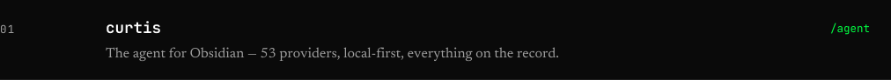</a>
  <a href="https://github.com/JordanNewell/dot_curt">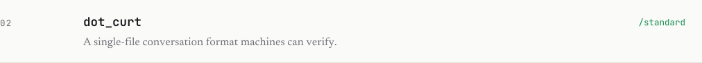</a>
  <a href="https://github.com/JordanNewell/curtis-ai-porter">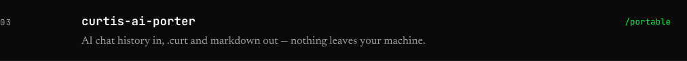</a>
  <a href="https://github.com/JordanNewell/curtis-ai-audit">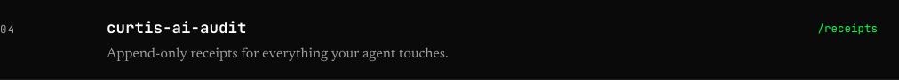</a>
  <a href="https://github.com/JordanNewell/token-hunt">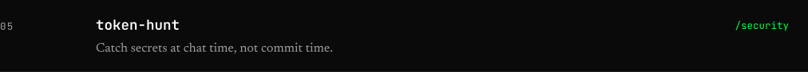</a>
  <a href="https://github.com/JordanNewell/pat-scanner">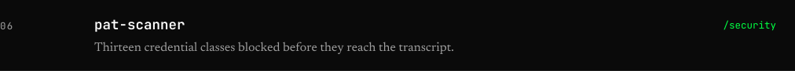</a>
  <a href="https://github.com/JordanNewell/curtis-compliance">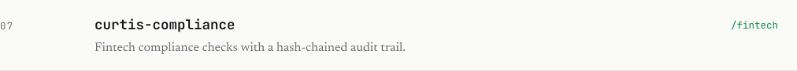</a>
  <a href="https://github.com/JordanNewell/newell-typeface">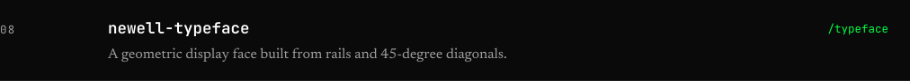</a>

  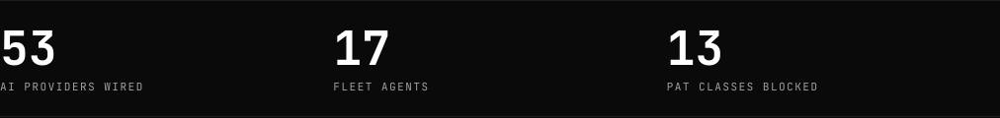

Earlier instruments: [`temporal-git`](https://github.com/JordanNewell/temporal-git) · [`harbormasterd`](https://github.com/JordanNewell/harbormasterd) · [`crypto-key-classifier`](https://github.com/JordanNewell/crypto-key-classifier) · [`claudeway`](https://github.com/JordanNewell/tractum) · [`interleaf`](https://github.com/JordanNewell/interleaf) · [`git-hygiene`](https://github.com/JordanNewell/git-hygiene)

In the wild: [curtisai.tech](https://curtisai.tech) · [tokenhunt.dev](https://tokenhunt.dev) · [getmedrecall.com](https://getmedrecall.com) · [interleaf.dev](https://interleaf.dev)

  

  <a href="https://jordannewell.com">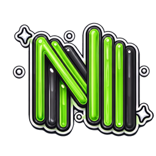</a>

