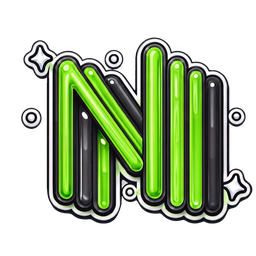

  

  <a href="https://jordannewell.com/">now</a>
  ·
  <a href="https://jordannewell.com/products/">products</a>
  ·
  <a href="https://jordannewell.com/papers/">papers</a>
  ·
  <a href="https://jordannewell.com/posts/">posts</a>
  ·
  <a href="https://jordannewell.com/rss.xml">rss</a>
  ·
  <a href="https://github.com/sponsors/JordanNewell">sponsors</a>

**Building**

- [`curtis`](https://github.com/curtis-ai-tech/curtis) — AI chat for Obsidian
- [`dot_curt`](https://github.com/dotcurt/dot_curt) — the `.curt` conversation format
- [`newell-typeface`](https://github.com/JordanNewell/newell-typeface) — geometric display face

Also: [`token-hunt`](https://github.com/JordanNewell/token-hunt) · [`pat-scanner`](https://github.com/JordanNewell/pat-scanner) · [`curtis-compliance`](https://github.com/curtis-ai-tech/curtis-compliance)

**Orgs:** [`curtis-ai-tech`](https://github.com/curtis-ai-tech) · [`dotcurt`](https://github.com/dotcurt)

In the wild: [curtisai.tech](https://curtisai.tech) · [tokenhunt.dev](https://tokenhunt.dev) · [getmedrecall.com](https://getmedrecall.com) · [interleaf.dev](https://interleaf.dev)

  

<b>LICENSE</b> 
Content and design © Jordan Newell. Code samples in linked repositories carry their own licenses (mostly MIT). This profile repository itself: all rights reserved.
