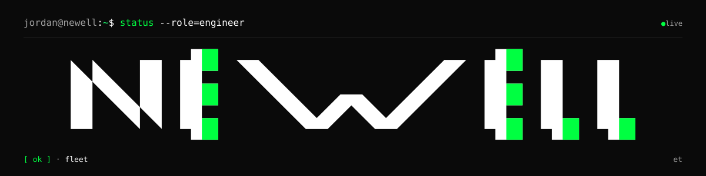

  

**Eastern Time** · founder of [@curtis-ai-tech](https://github.com/curtis-ai-tech) · [@dotcurt](https://github.com/dotcurt) · [@leverframe](https://github.com/leverframe) · [@idiomark](https://github.com/idiomark) · [@tokenhunt](https://github.com/tokenhunt) · [@humannewell](https://github.com/humannewell) · everything runs on files I own

I build local-first AI tooling — chat that stays on your machine, formats machines can verify, and receipts for everything agents touch. One thing gets the attention. Everything else runs quiet.

## /orgs

- [**curtis-ai-tech**](https://github.com/curtis-ai-tech) — local-first AI tooling that lives where your work lives. Home of [curtis](https://github.com/curtis-ai-tech/curtis): AI chat for Obsidian. Polyglot, local-first, on the record.
- [**dotcurt**](https://github.com/dotcurt) — the open single-file format for AI conversations. [dot_curt](https://github.com/dotcurt/dot_curt): one file, one conversation, kept whole.
- [**leverframe**](https://github.com/leverframe) — agent infrastructure. [tractum](https://github.com/leverframe/tractum): verifiable multi-agent consensus · [wranglebot](https://github.com/leverframe/wranglebot): deterministic guardrails for coding agents · [skillguard](https://github.com/leverframe/skillguard): signed plugin directory.
- [**idiomark**](https://github.com/idiomark) — the personality format for AI. A portable `.idiomark` file: how a person speaks and thinks, portable to any system.
- [**tokenhunt**](https://github.com/tokenhunt) — catch secrets at chat time, not commit time. [token-hunt](https://github.com/tokenhunt/token-hunt) + [pat-scanner](https://github.com/tokenhunt/pat-scanner).
- [**humannewell**](https://github.com/humannewell) — software that advances quality of life. Building for public good, one initiative at a time.

## /start-here

- [**newell-typeface**](https://github.com/JordanNewell/newell-typeface) — geometric display face built from rails and 45° diagonals.
- [**tangent-typeface**](https://github.com/JordanNewell/tangent-typeface) — Newell's sibling: rails, 45° diagonals, perfect-circle arcs.
- [**openclaw-guru**](https://github.com/JordanNewell/openclaw-guru) — expert OpenClaw subagent; knowledge kept fresh by machine

## /writing

[papers](https://jordannewell.com/papers/) · [posts](https://jordannewell.com/posts/) · [rss](https://jordannewell.com/rss.xml) — ORCID [0009-0003-5003-5949](https://orcid.org/0009-0003-5003-5949)

  

  

